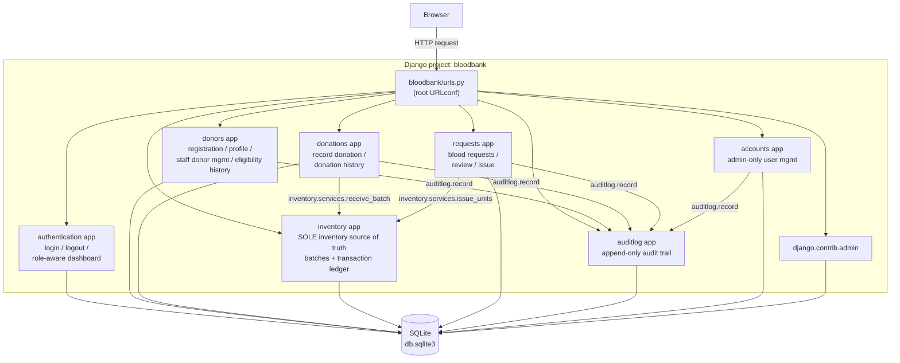
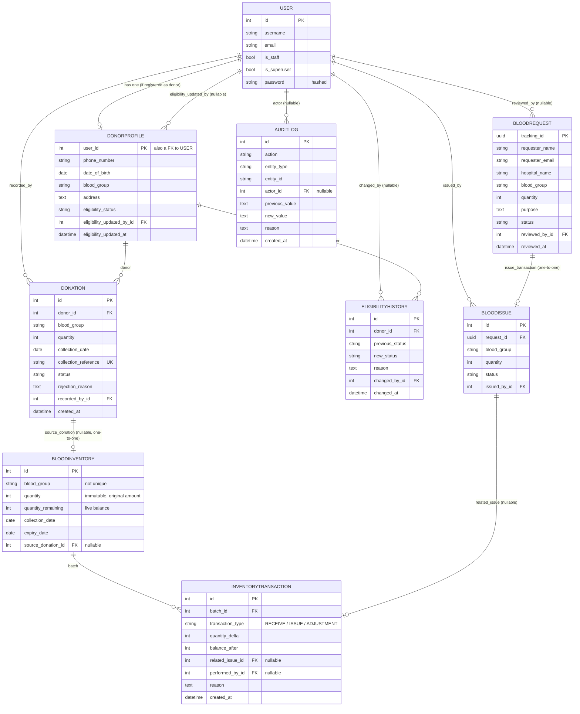
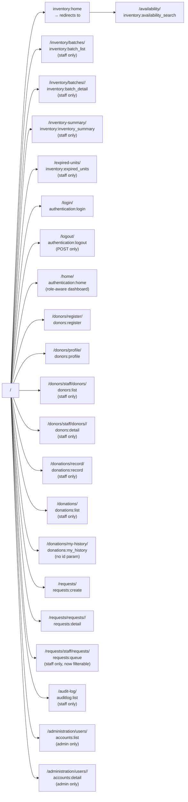
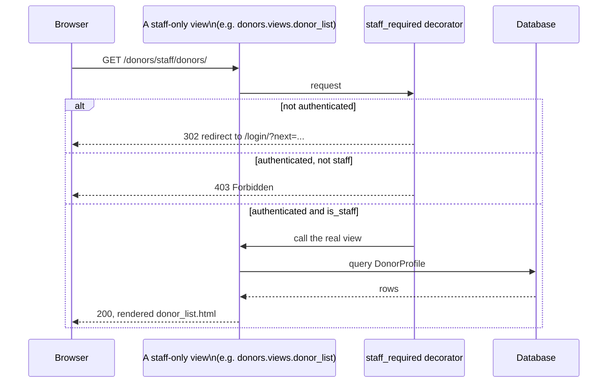
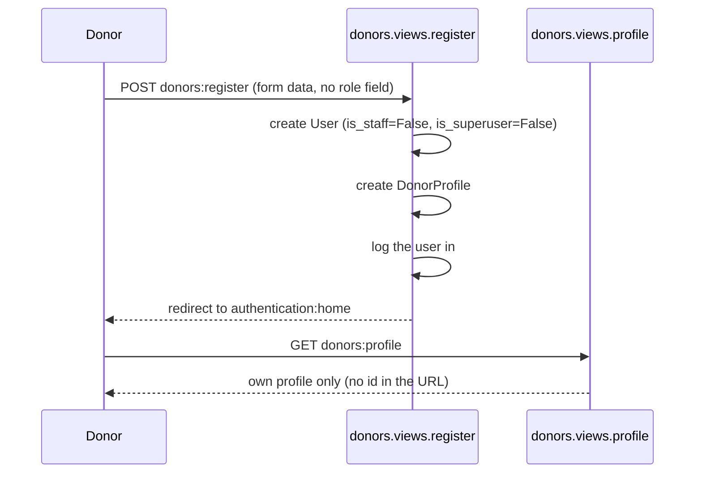
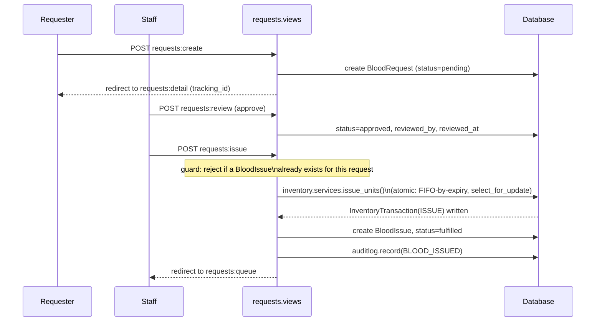
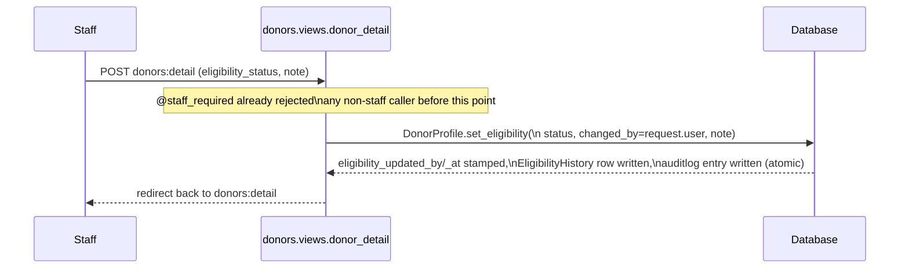
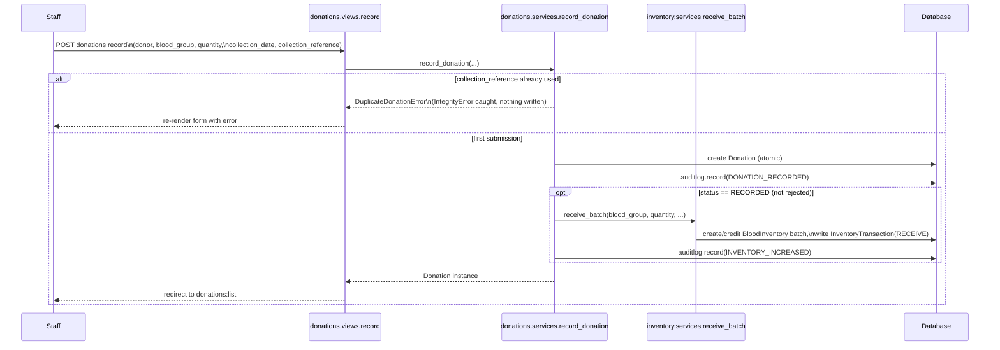
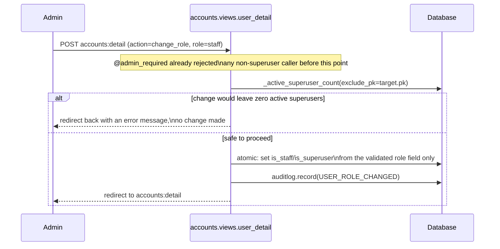

# Architecture

This document describes the actual structure of the codebase as it
stands on `main` — not an idealized target architecture. Earlier
versions of this document described two independent `BloodInventory`
models; that inconsistency has since been fixed (one source of truth
in `inventory`, with a data migration — see §4 and
[`KNOWN_ISSUES.md`](KNOWN_ISSUES.md) §1) and this document now
describes the fixed state. Anything still genuinely a wart is named
here and cross-referenced to [`KNOWN_ISSUES.md`](KNOWN_ISSUES.md)
rather than smoothed over.

## 1. Overall architecture

A single Django project (`bloodbank/`) with seven installed apps, a
SQLite database, and server-rendered HTML templates — no REST API, no
separate frontend build, no JavaScript framework. Django's Model-View-
Template (MVT) pattern throughout, with one addition over the original
two-sprint codebase: a thin **service layer** (`inventory/services.py`,
`donations/services.py`) for the operations that must touch more than
one table atomically. Views call services or the ORM directly and
render a template; there is still no repository/DAO layer.



## 2. Django project structure

```
bloodbank/            project package: settings.py, urls.py, wsgi.py, asgi.py, constants.py
authentication/       app: login, logout, role-aware dashboard
donors/               app: donor self-registration, profile, staff management, eligibility history
donations/            app: record a donation, donor/staff donation history
inventory/            app: THE inventory source of truth — batches, services, transaction ledger
requests/             app: blood request submission, review, issue/distribution
auditlog/             app: the one append-only audit trail every other app writes to
accounts/             app: administrator-only user management (built on Django's own User model)
templates/base.html   project-level shared template (TEMPLATES['DIRS'] in settings.py)
```

`bloodbank/settings.py` lists all seven apps in `INSTALLED_APPS` (plus
Django's own contrib apps). App load order does not affect URL
routing — that is controlled entirely by `bloodbank/urls.py`.
`bloodbank/constants.py` is new: a single module holding the blood
group choice list and the two documented project assumptions
(`WHOLE_BLOOD_SHELF_LIFE_DAYS = 42`, `MIN_DAYS_BETWEEN_DONATIONS = 90`)
that `donors`, `donations`, `inventory` and `requests` all import from,
instead of each defining its own copy.

## 3. Apps and their responsibilities

### `authentication`

- **Purpose:** session login/logout and the role-aware dashboard.
- **Views** (`authentication/views.py`): `LoginView` (subclasses Django's
  built-in `auth_views.LoginView`, with a custom form that accepts a
  username *or* an e-mail address) and `home` (`@login_required`;
  branches into `_staff_dashboard_context()` or
  `_donor_dashboard_context()` depending on `request.user.is_staff`,
  each building its figures from live queries — see §9).
- **Decorators** (`authentication/decorators.py`): `staff_required` —
  the RBAC enforcement point every staff-only view across the project
  uses (redirects anonymous users to login; raises `PermissionDenied`
  for authenticated non-staff users) — and `admin_required`, the same
  pattern but checking `is_superuser` specifically, used by `accounts`.
- **No model of its own** — uses Django's built-in `auth.User`.

### `donors`

- **Purpose:** everything specific to a donor account: self-registration,
  self-service profile, and the staff-facing donor directory and
  eligibility workflow.
- **Models** (`donors/models.py`): `DonorProfile`, `EligibilityHistory`
  (new — see §4).
- **Views** (`donors/views.py`): `register` (public), `profile`
  (`@login_required`, always operates on `request.user`), `donor_list`
  (`@staff_required`, paginated, searchable), `donor_detail`
  (`@staff_required`, takes a `pk`; also handles the eligibility-update
  POST, which now calls `DonorProfile.set_eligibility()`).
- **Forms** (`donors/forms.py`): `DonorRegistrationForm` (plain `Form`,
  not a `ModelForm` against `User` — deliberately has no `is_staff` /
  `is_superuser` field), `DonorProfileUpdateForm` (`ModelForm` against
  `DonorProfile`, plus three plain fields for the linked `User`'s name/
  email — no eligibility field), `EligibilityUpdateForm` (plain `Form`,
  used only by the staff-only `donor_detail` view).
- **`set_eligibility()`** (`DonorProfile` instance method): one
  `transaction.atomic()` block that updates the summary fields
  (`eligibility_status`, `eligibility_updated_by`,
  `eligibility_updated_at`), writes an `EligibilityHistory` row, and
  calls `auditlog.record(Action.ELIGIBILITY_CHANGED, ...)` — all three
  or none.
- **Management command:** `seed_demo_data` — idempotent dev-data seeding.

### `donations` (new this patch series)

- **Purpose:** staff recording of a blood donation, with duplicate-
  submission protection, and donation history for both the donor
  (self-service) and staff (operational lookup).
- **Model** (`donations/models.py`): `Donation` — see §4. A **unique**
  `collection_reference` field is the concrete guard against double-
  crediting the same physical donation.
- **Services** (`donations/services.py`): `record_donation()` — the one
  entry point, `@transaction.atomic`. Always writes the `Donation` row
  and a `DONATION_RECORDED` audit entry; only when the recorded status
  is `RECORDED` (not `REJECTED`) does it call
  `inventory.services.receive_batch()` to credit stock, plus an
  `INVENTORY_INCREASED` audit entry. A resubmission with the same
  `collection_reference` raises `DuplicateDonationError` (caught from
  the database's own unique-constraint `IntegrityError`, not a
  pre-check that could itself race) and credits nothing.
- **Views** (`donations/views.py`): `record` (`@staff_required`),
  `donation_list` (`@staff_required`, search/filter/pagination),
  `my_donation_history` (`@login_required`, **no pk parameter at
  all** — the IDOR defense is structural, not a permission check),
  `donor_donation_history` (`@staff_required`, takes a `pk` for staff's
  operational lookup of a specific donor).

### `inventory`

- **Purpose:** the project's single source of truth for blood stock —
  availability search, the staff batch dashboard, and the only code
  path (`inventory/services.py`) allowed to change stock levels.
- **Models** (`inventory/models.py`): `BloodInventory` — per-batch
  record (`blood_group`, `quantity` immutable original amount,
  `quantity_remaining` live balance, `collection_date`, `expiry_date`,
  optional `source_donation` link); `InventoryTransaction` — an
  append-only ledger row for every receive/issue/adjustment (see §4).
- **Services** (`inventory/services.py`, new): `available_units()`
  (sums non-expired, non-depleted batches), `receive_batch()`
  (`@transaction.atomic`, defaults `expiry_date` from
  `bloodbank.constants.WHOLE_BLOOD_SHELF_LIFE_DAYS` when not given),
  `issue_units()` (`@transaction.atomic`, `select_for_update()` on
  candidate batches ordered FIFO by `expiry_date`, raises before any
  write if stock is insufficient), `adjust_batch()` (requires a
  non-empty reason, rejects a negative resulting balance). Every
  mutation writes a matching `InventoryTransaction` row.
- **Views** (`inventory/views.py`): `home` (redirects to availability
  search), `availability_search` (`@login_required`, unchanged access
  control — deliberately not made public, see §7), `batch_list` /
  `batch_detail` (new, `@staff_required`, search/pagination and a
  manual-adjustment form with transaction history), `inventory_summary`
  (`@staff_required`, now shows batch counts, 7-day expiring-soon
  counts, and recent `InventoryTransaction` rows instead of a bare
  per-group sum).

### `requests`

- **Purpose:** blood request submission, staff review, and blood
  issue/distribution.
- **Models** (`requests/models.py`): `BloodRequest`, `BloodIssue`. The
  aggregate `BloodInventory` model this app used to define has been
  **removed** — `requests` no longer stores stock of its own; see §4.
- **Views** (`requests/views.py`): `request_create` (public),
  `request_detail` (public, looked up by the request's UUID
  `tracking_id` — see [`KNOWN_ISSUES.md`](KNOWN_ISSUES.md) for the
  access-control reasoning), `request_queue` (staff-only; now also
  supports `status`/`blood_group`/`hospital` search filters and
  pagination), `request_review` and `issue_blood` (staff-only,
  POST-only; `issue_blood` now calls
  `inventory.services.issue_units()` instead of decrementing a local
  row, and explicitly guards against a second issue against the same
  request).

### `auditlog` (new this patch series)

- **Purpose:** the single append-only audit trail every other app
  writes to, covering all 14 action types named in the project's audit
  logging requirement (donation recorded/modified/cancelled; inventory
  increased/decreased/adjusted; request submitted/approved/rejected/
  status changed; blood issued; donor eligibility changed; user
  created/role changed/activated-deactivated).
- **Model** (`auditlog/models.py`): `AuditLog` — see §4. `record()` is
  a module-level function, not a model method, so every app calls the
  same code path (`auditlog.models.record(...)`) rather than each
  constructing its own `AuditLog.objects.create(...)` call with
  slightly different field conventions.
- **Admin registration** (`auditlog/admin.py`): registered read-only —
  `has_add_permission`/`has_change_permission`/`has_delete_permission`
  all return `False`, so even a superuser can view but not edit or
  delete audit history from the Django admin site.
- **Views** (`auditlog/views.py`): `audit_log_list` (`@staff_required`,
  filterable by action/entity type, paginated).

### `accounts` (new this patch series)

- **Purpose:** administrator-only CRUD on user accounts and roles,
  built entirely on Django's own `auth.User` model — no parallel auth
  system.
- **No new models** — operates on `django.contrib.auth.models.User`.
- **Forms** (`accounts/forms.py`): `AdminUserCreateForm` (subclasses
  Django's `UserCreationForm`; has an explicit `role` `ChoiceField`
  that `save()` translates into `is_staff`/`is_superuser` — a raw POST
  field named `is_staff` or `is_superuser` is never read directly),
  `AdminUserUpdateForm`, `RoleChangeForm`, `UserSearchForm`.
- **Views** (`accounts/views.py`): `user_list` (`@admin_required`,
  search/filter/pagination), `user_create` (`@admin_required`),
  `user_detail` (`@admin_required`; three explicit POST `action`
  branches — `update_details`, `change_role`, `toggle_active` — each
  calling `auditlog.record()`). `change_role` and `toggle_active` both
  check `_active_superuser_count()` first and refuse the change if it
  would leave zero active superusers.
- **URLs:** mounted at `administration/users/...`, not `admin/users/...`
  — see [`KNOWN_ISSUES.md`](KNOWN_ISSUES.md) DEFECT-01 for why
  `admin/` specifically was unusable (Django's root URLconf already
  consumes that whole prefix for `django.contrib.admin`).

## 4. Models and relationships



`requests` no longer defines its own `BloodInventory` model — the
aggregate table it used to own was removed by
`requests/migrations/0003_remove_duplicate_inventory.py`, which first
converts any pre-existing rows into `inventory.BloodInventory` batches
(assuming the documented 42-day shelf life from the migration date,
since the old aggregate model never recorded a real collection date —
see [`KNOWN_ISSUES.md`](KNOWN_ISSUES.md) §8.2) so no deployment's
existing stock numbers are silently lost. `BLOODINVENTORY` above is
`inventory.BloodInventory`, the single remaining model, and the only
one `requests.views.issue_blood` and `donations.services.record_donation`
now touch.

`DonorProfile.user` is the model's primary key (`OneToOneField(...,
primary_key=True)`) — a `DonorProfile` and the `User` it extends share
one row ID, not two. `Donation.collection_reference` is the unique
field that makes resubmitting the same physical donation a rejected
`IntegrityError`, not a silent double-credit.

## 5. Views and URL routing

Root URLconf (`bloodbank/urls.py`) mounts each app under a namespace:

| URL prefix | App | Namespace |
|---|---|---|
| `/admin/` | `django.contrib.admin` | `admin` |
| `/` (and sub-paths) | `inventory` | `inventory` |
| `/requests/` | `requests` | `requests` |
| `/donors/` | `donors` | `donors` |
| `/donations/` | `donations` | `donations` |
| `/audit-log/` | `auditlog` | `auditlog` |
| `/administration/users/` | `accounts` | `accounts` |
| `/login/`, `/logout/`, `/home/` | `authentication` | `authentication` |



Every app except `authentication` and `inventory` declares `app_name`
and is included with its own namespace; `inventory` also declares
`app_name = "inventory"` (added in Sprint 2 — see
[`SPRINT2_REPORT.md`](../SPRINT2_REPORT.md) for why the bare, unnamespaced
view names it used to export were fragile). `accounts` is mounted at
`administration/users/`, not `admin/users/` — see
[`KNOWN_ISSUES.md`](KNOWN_ISSUES.md) DEFECT-01: `admin/` is already
fully consumed by `django.contrib.admin`'s own `path("admin/", ...)`
entry earlier in `bloodbank/urls.py`, so Django's resolver never reaches
a second app mounted under the same prefix.

## 6. Templates

Every template in the project extends one shared, project-level
`templates/base.html` (registered via `TEMPLATES[0]['DIRS']` in
`settings.py`, which Django's filesystem loader checks before any app's
own `templates/` directory). It defines:

- The page shell (`<head>`, a `.card`-based layout, the oxblood/crimson/
  ivory/porcelain/charcoal/champagne/rose design-token palette).
- A **light/dark/system theme switcher**: a blocking inline `<script>`
  in `<head>`, before any stylesheet, reads `localStorage` (falling
  back to `prefers-color-scheme`) and sets `data-theme` on `<html>`
  before first paint, so there is no flash of the wrong theme; a second
  script at the end of `<body>` wires the three-button switcher and a
  live `matchMedia` listener for "system" mode. No external font or CDN
  dependency — system font stacks only, vanilla JS only, no new
  frontend dependency, per the project's technical constraints.
- A header nav bar that adapts to the viewer's role (donor-only,
  staff-only and admin-only links are both hidden from the nav *and*
  independently re-checked by every view's own decorator — the nav
  hiding a link is a convenience, never the actual access control).
- The logout control: a POST form with a CSRF token, present on every
  page a logged-in user can reach — this exists specifically because an
  earlier version of the project (pre-Sprint 2) had no logout control at
  all on the `inventory` and `requests` apps' own pages. See
  [`SPRINT2_REPORT.md`](../SPRINT2_REPORT.md) §A/D.
- Shared CSS for the new dashboard (`.metric-grid`/`.metric-card`
  KPI tiles, a `.bar-chart` family rendered with Django's
  `` — no JS charting library), `.grid-2-cards`, a
  mobile table horizontal-scroll fallback, `focus-visible` outlines, and
  a global `@media (prefers-reduced-motion: reduce)` rule.
- A `` every page template fills in.



```mermaid
flowchart TB
    base["templates/base.html\n(shared shell + theme switcher + nav + logout form)"]
    base --> login_t["authentication/login.html"]
    base --> home_t["authentication/home.html\n(staff OR donor dashboard)"]
    base --> register_t["donors/register.html"]
    base --> profile_t["donors/profile.html"]
    base --> donor_list_t["donors/donor_list.html"]
    base --> donor_detail_t["donors/donor_detail.html"]
    base --> don_record_t["donations/record.html"]
    base --> don_list_t["donations/donation_list.html"]
    base --> don_my_t["donations/my_history.html"]
    base --> avail_t["inventory/availability_search.html"]
    base --> batch_list_t["inventory/batch_list.html"]
    base --> batch_detail_t["inventory/batch_detail.html"]
    base --> inv_summary_t["inventory/inventory_summary.html"]
    base --> expired_t["inventory/expired_units.html"]
    base --> req_form_t["requests/request_form.html"]
    base --> req_detail_t["requests/request_detail.html"]
    base --> req_queue_t["requests/request_queue.html\n(now with search/filter)"]
    base --> audit_t["auditlog/audit_log_list.html"]
    base --> ulist_t["accounts/user_list.html"]
    base --> ucreate_t["accounts/user_create.html"]
    base --> udetail_t["accounts/user_detail.html"]
```

## 7. Authentication and authorization flow



Session authentication is entirely Django's built-in machinery
(`django.contrib.sessions`, `django.contrib.auth`); no custom token or
JWT handling exists anywhere in the codebase. `LOGIN_URL`,
`LOGIN_REDIRECT_URL` and `LOGOUT_REDIRECT_URL` in `settings.py` point at
the `authentication` app's named URLs.

Authorization (who can do what once logged in) is role-based, not
object-level, for staff/admin actions — see the
[role-permission matrix in the README](../README.md#user-roles-and-permissions).
The one place an ID-based ownership check genuinely matters —
`donors:profile`, a donor's own data — is handled by never accepting an
ID at all: the view always operates on `request.user`.

## 8. Database interaction

Every app uses Django's ORM exclusively — no raw SQL anywhere in the
application code (`sqlparse` is a transitive dependency of Django itself,
not used directly). Explicit transaction control now lives in the
service layer rather than being scattered across views:

- `inventory.services.issue_units()` — `@transaction.atomic`,
  `select_for_update()` on candidate batches (FIFO by `expiry_date`),
  raises before any write if stock is insufficient. Called by
  `requests/views.py:issue_blood`, which separately guards against a
  second issue against the same request.
- `inventory.services.receive_batch()` / `adjust_batch()` —
  `@transaction.atomic`; `adjust_batch()` additionally requires a
  non-empty reason and rejects a negative resulting balance.
- `donations.services.record_donation()` — `@transaction.atomic`;
  creates the `Donation` row and, only on a `RECORDED` outcome, calls
  `receive_batch()` and writes an audit entry, all inside the same
  transaction, so a donation is never recorded with its inventory
  credit silently missing (or vice versa).
- `DonorProfile.set_eligibility()` — `@transaction.atomic`; updates the
  summary fields, writes an `EligibilityHistory` row, and writes an
  audit entry together.
- `accounts.views.user_detail`'s `change_role`/`toggle_active` POST
  handlers — each wraps its `User` field change and its
  `auditlog.record()` call in one transaction, and checks
  `_active_superuser_count()` first so the check and the write can't
  be separated by a race.

## 9. Main workflows

### Donor registration → login → profile



### Blood request → staff review → issue



### Staff eligibility update



### Staff records a donation



### Administrator manages a user account



A crafted POST from a non-admin account that includes `role=admin` (or
raw `is_staff=True`/`is_superuser=True` fields) is rejected before this
flow is ever reached — `@admin_required` runs first, and even an admin's
own legitimate `role` value is read only from the validated
`ChoiceField`, never from an arbitrary POST key. See
`accounts/tests.py::test_staff_cannot_create_admin_account_via_crafted_post`.
