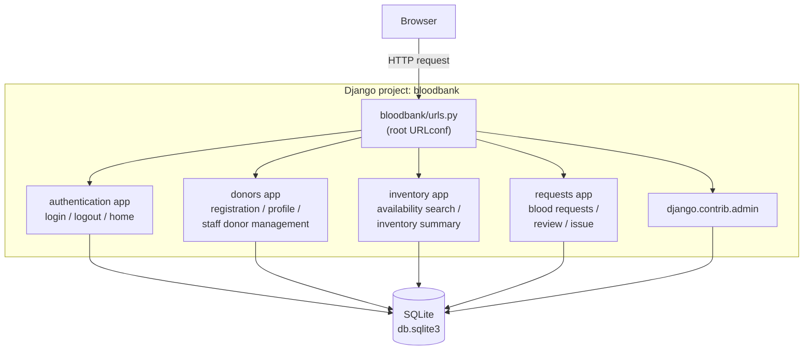
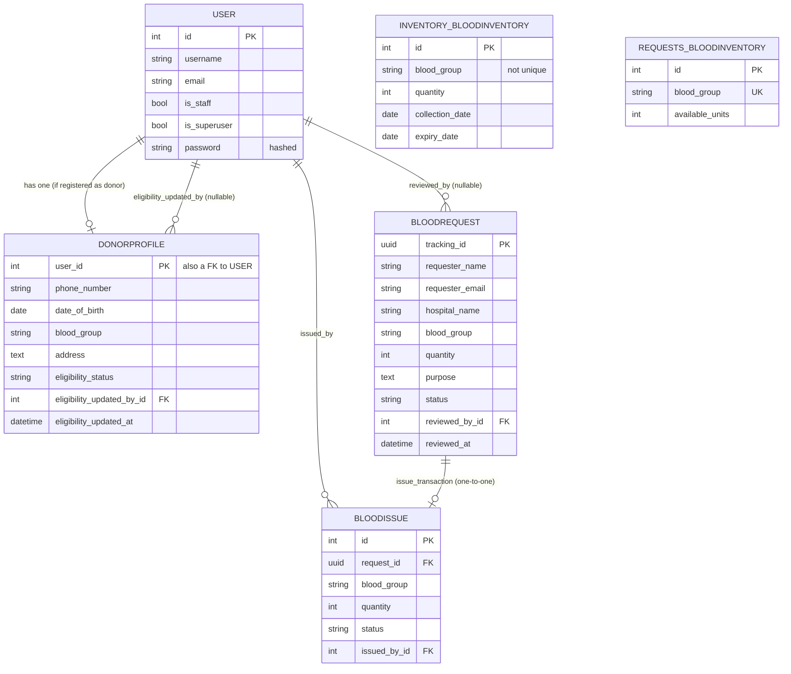
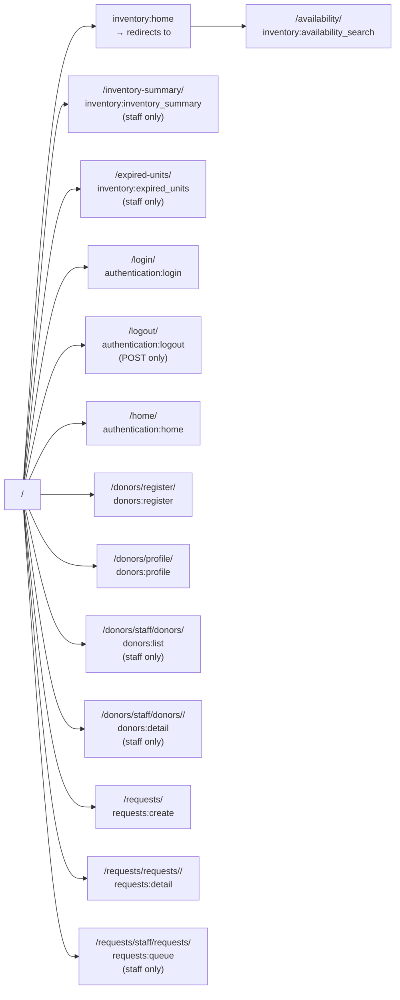
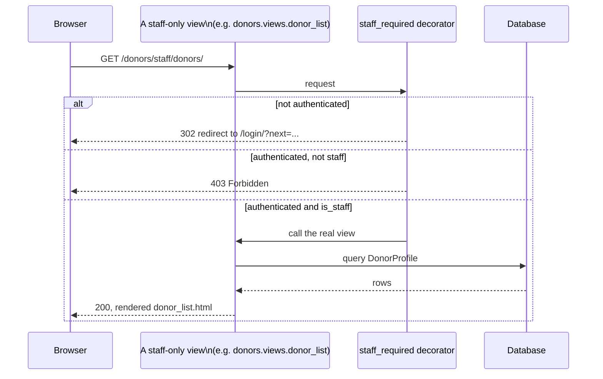
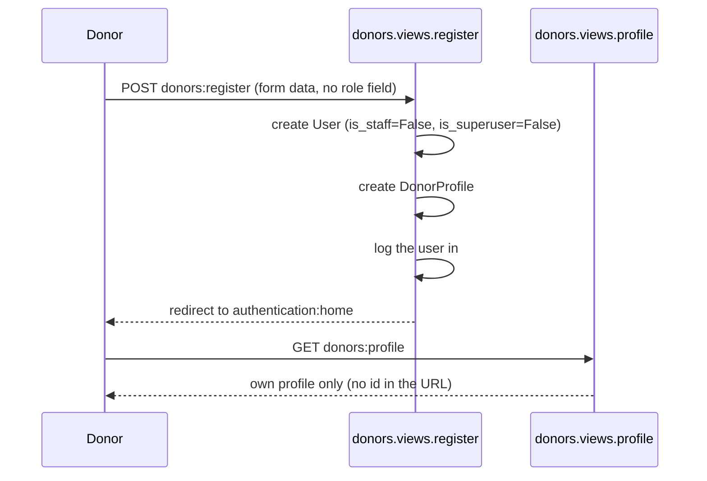
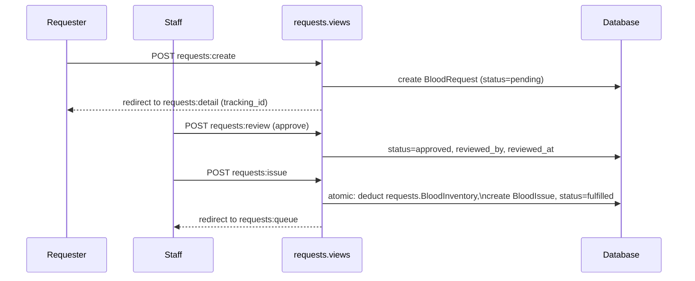
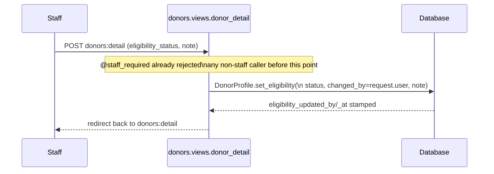

# Architecture

This document describes the actual structure of the codebase as it
stands on `main` — not an idealized target architecture. Where the real
structure has a wart (e.g. two `BloodInventory` models), it's named here
and cross-referenced to [`KNOWN_ISSUES.md`](KNOWN_ISSUES.md) rather than
smoothed over.

## 1. Overall architecture

A single Django project (`bloodbank/`) with four installed apps, a
SQLite database, and server-rendered HTML templates — no REST API, no
separate frontend build, no JavaScript framework. Django's Model-View-
Template (MVT) pattern throughout: views call the ORM directly and render
a template; there is no service/repository layer in between.



## 2. Django project structure

```
bloodbank/            project package: settings.py, urls.py, wsgi.py, asgi.py
authentication/       app: login, logout, authenticated landing page
donors/               app: donor self-registration, profile, staff management
inventory/            app: availability search, inventory summary, expired units
requests/             app: blood request submission, review, issue/distribution
templates/base.html   project-level shared template (TEMPLATES['DIRS'] in settings.py)
```

`bloodbank/settings.py` lists the four apps in `INSTALLED_APPS` in this
order: `inventory`, `requests`, `authentication`, `donors` (plus Django's
own contrib apps). App load order does not affect URL routing — that is
controlled entirely by `bloodbank/urls.py`.

## 3. Apps and their responsibilities

### `authentication`

- **Purpose:** session login/logout and the authenticated landing page.
- **Views** (`authentication/views.py`): `LoginView` (subclasses Django's
  built-in `auth_views.LoginView`, with a custom form that accepts a
  username *or* an e-mail address) and `home` (a minimal `@login_required`
  landing page).
- **Decorators** (`authentication/decorators.py`): `staff_required` — the
  one RBAC enforcement point every staff-only view across the project
  uses. Redirects anonymous users to login; raises `PermissionDenied`
  (HTTP 403) for authenticated non-staff users.
- **No model of its own** — uses Django's built-in `auth.User`.

### `donors`

- **Purpose:** everything specific to a donor account: self-registration,
  self-service profile, and the staff-facing donor directory and
  eligibility workflow.
- **Model** (`donors/models.py`): `DonorProfile` — see §4.
- **Views** (`donors/views.py`): `register` (public), `profile`
  (`@login_required`, always operates on `request.user`), `donor_list`
  (`@staff_required`, paginated, searchable), `donor_detail`
  (`@staff_required`, takes a `pk`; also handles the eligibility-update
  POST).
- **Forms** (`donors/forms.py`): `DonorRegistrationForm` (plain `Form`,
  not a `ModelForm` against `User` — deliberately has no `is_staff` /
  `is_superuser` field), `DonorProfileUpdateForm` (`ModelForm` against
  `DonorProfile`, plus three plain fields for the linked `User`'s name/
  email — no eligibility field), `EligibilityUpdateForm` (plain `Form`,
  used only by the staff-only `donor_detail` view).
- **Management command:** `seed_demo_data` — idempotent dev-data seeding.

### `inventory`

- **Purpose:** blood availability search and staff inventory views.
- **Model** (`inventory/models.py`): `BloodInventory` — per-batch record
  (`blood_group`, `quantity`, `collection_date`, `expiry_date`).
- **Views** (`inventory/views.py`): `home` (redirects to availability
  search), `availability_search` (`@login_required`, sums non-expired
  batches for a chosen blood group), `inventory_summary`
  (`@staff_required`, same sum across all eight groups), `expired_units`
  (`@staff_required`, lists batches past `expiry_date`).

### `requests`

- **Purpose:** blood request submission, staff review, and blood
  issue/distribution.
- **Models** (`requests/models.py`): `BloodRequest`, `BloodInventory`
  (a **different** model from `inventory.BloodInventory` — see §4 and
  [`KNOWN_ISSUES.md`](KNOWN_ISSUES.md)), `BloodIssue`.
- **Views** (`requests/views.py`): `request_create` (public),
  `request_detail` (public, looked up by the request's UUID
  `tracking_id` — see [`KNOWN_ISSUES.md`](KNOWN_ISSUES.md) for the
  access-control reasoning), `request_queue` (staff-only, via a local
  `user_passes_test(is_staff)` check rather than the shared
  `staff_required` decorator — a minor inconsistency, not a hole:
  both reject non-staff), `request_review` and `issue_blood` (staff-only,
  POST-only).

## 4. Models and relationships



`INVENTORY_BLOODINVENTORY` and `REQUESTS_BLOODINVENTORY` are deliberately
drawn as unconnected in this diagram — they are two separate Django
models (`inventory.BloodInventory`, `requests.BloodInventory`) backed by
two separate database tables, with no foreign key or sync mechanism
between them. See [`KNOWN_ISSUES.md`](KNOWN_ISSUES.md) §1.

`DonorProfile.user` is the model's primary key (`OneToOneField(...,
primary_key=True)`) — a `DonorProfile` and the `User` it extends share
one row ID, not two.

## 5. Views and URL routing

Root URLconf (`bloodbank/urls.py`) mounts each app under a namespace:

| URL prefix | App | Namespace |
|---|---|---|
| `/admin/` | `django.contrib.admin` | `admin` |
| `/` (and sub-paths) | `inventory` | `inventory` |
| `/requests/` | `requests` | `requests` |
| `/donors/` | `donors` | `donors` |
| `/login/`, `/logout/`, `/home/` | `authentication` | `authentication` |



Every app except `authentication` and `inventory` declares `app_name`
and is included with its own namespace; `inventory` also declares
`app_name = "inventory"` (added in Sprint 2 — see
[`SPRINT2_REPORT.md`](../SPRINT2_REPORT.md) for why the bare, unnamespaced
view names it used to export were fragile).

## 6. Templates

Every template in the project extends one shared, project-level
`templates/base.html` (registered via `TEMPLATES[0]['DIRS']` in
`settings.py`, which Django's filesystem loader checks before any app's
own `templates/` directory). It defines:

- The page shell (`<head>`, a `.card`-based layout, the color/typography
  system).
- A header nav bar that adapts to the viewer's role (shows "Donors" /
  "Request queue" / "Inventory" only to staff, "My profile" only to
  non-staff authenticated users, "Register as donor" / "Log in" only to
  anonymous visitors).
- The logout control: a POST form with a CSRF token, present on every
  page a logged-in user can reach — this exists specifically because an
  earlier version of the project (pre-Sprint 2) had no logout control at
  all on the `inventory` and `requests` apps' own pages. See
  [`SPRINT2_REPORT.md`](../SPRINT2_REPORT.md) §A/D.
- A `` every page template fills in.



```mermaid
flowchart TB
    base["templates/base.html\n(shared shell + nav + logout form)"]
    base --> login_t["authentication/login.html"]
    base --> home_t["authentication/home.html"]
    base --> register_t["donors/register.html"]
    base --> profile_t["donors/profile.html"]
    base --> donor_list_t["donors/donor_list.html"]
    base --> donor_detail_t["donors/donor_detail.html"]
    base --> avail_t["inventory/availability_search.html"]
    base --> inv_summary_t["inventory/inventory_summary.html"]
    base --> expired_t["inventory/expired_units.html"]
    base --> req_form_t["requests/request_form.html"]
    base --> req_detail_t["requests/request_detail.html"]
    base --> req_queue_t["requests/request_queue.html"]
```

## 7. Authentication and authorization flow



Session authentication is entirely Django's built-in machinery
(`django.contrib.sessions`, `django.contrib.auth`); no custom token or
JWT handling exists anywhere in the codebase. `LOGIN_URL`,
`LOGIN_REDIRECT_URL` and `LOGOUT_REDIRECT_URL` in `settings.py` point at
the `authentication` app's named URLs.

Authorization (who can do what once logged in) is role-based, not
object-level, for staff/admin actions — see the
[role-permission matrix in the README](../README.md#user-roles-and-permissions).
The one place an ID-based ownership check genuinely matters —
`donors:profile`, a donor's own data — is handled by never accepting an
ID at all: the view always operates on `request.user`.

## 8. Database interaction

Every app uses Django's ORM exclusively — no raw SQL anywhere in the
application code (`sqlparse` is a transitive dependency of Django itself,
not used directly). `requests/views.py:issue_blood` is the one place with
explicit transaction control: it wraps the inventory deduction and
`BloodIssue` creation in `transaction.atomic()` with
`select_for_update()` on both the `BloodRequest` and `BloodInventory`
rows, to avoid a double-issue or negative-inventory race under concurrent
requests.

## 9. Main workflows

### Donor registration → login → profile



### Blood request → staff review → issue



### Staff eligibility update


